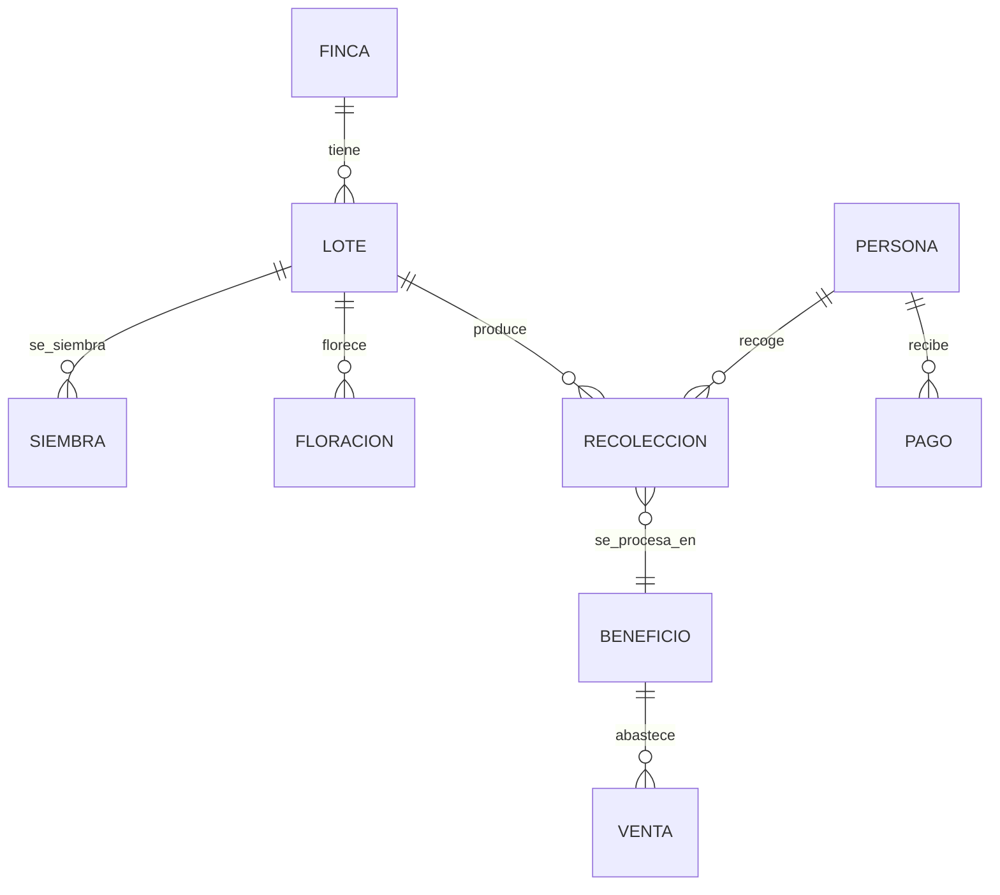

# Ontología de finca cafetera + LLM Wiki

Modelo de datos (estilo Palantir) y CLI para administrar una finca de café: lotes, siembras, floraciones, recolecciones, beneficio, pagos, ventas e indicadores.

> **Privacidad.** Sin nombres reales de personas, sin GPS real, sin montos ni compradores reales. Ejemplos con placeholders.

## Arquitectura



## Uso

```bash
python finca.py import-xlsx lotes_ejemplo.xlsx
python finca.py recoleccion 2026-10-14 "Recolector A" 40 --lote "Lote Norte"
python finca.py reporte --desde 2026-10-01 --hasta 2026-10-31
python finca.py agenda
python tools/sync_finca.py finca.db
```

## Autor

Juan Esteban Salcedo Moreno — Q Processing (CQI); ecosistema cafetero colombiano.
