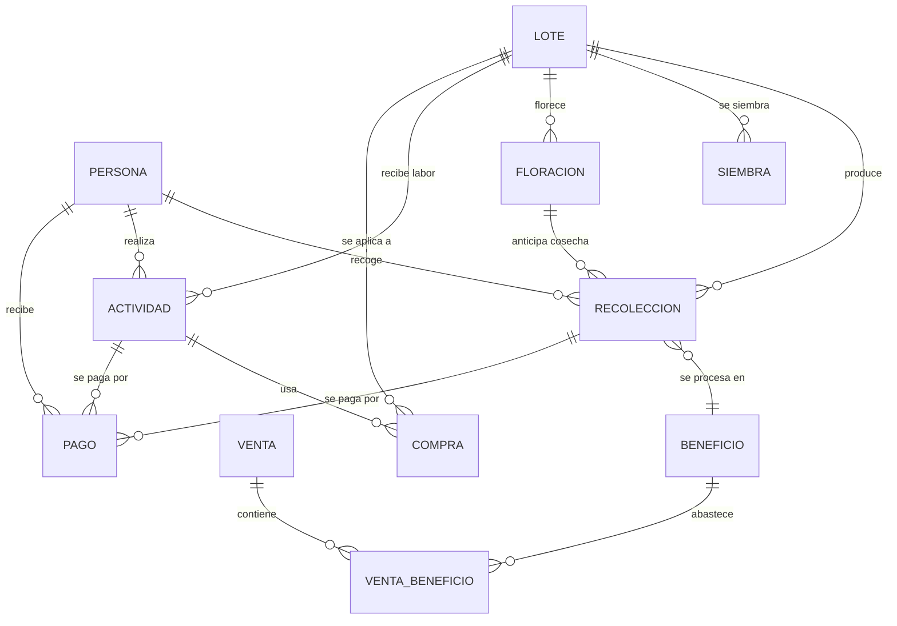

# Ontología de la finca

Así funciona, al estilo de Palantir: cada cosa de la finca es un **objeto**, cada objeto tiene **propiedades** y está **enlazado** con otros, y cada **evento** (recoger, beneficiar, pagar, vender) crea un registro nuevo que queda conectado al resto. Por eso una venta se puede seguir hacia atrás hasta el beneficio, la recolección, el recolector y el lote de donde salió.

## Objetos
- **Persona**: recolector o trabajador (nombre, rol).
- **Lote**: parte de la finca (número del Excel, número alterno, nombre, hectáreas, variedad, árboles).
- **Siembra**: siembra o renovación de un lote (fecha, variedad, distancias, plantas, fecha de próxima renovación).
- **Floración**: floración de un lote (fecha, calificación, fechas de control de roya y broca, cosecha estimada).
- **Recolección**: quién recogió cuántos kg de cereza, en qué fecha y en qué lote.
- **Beneficio**: un grupo de recolecciones procesadas, con los kg de cereza que entraron y los kg de pergamino seco que salieron. Así se calcula el factor real.
- **Actividad**: una labor (abonar, guadañar, fumigar) con fecha, persona, lote, jornales y costo.
- **Compra**: un insumo (abono, herramientas) con su valor. Puede ir asignada a un lote o a una actividad.
- **Pago**: lo que se le paga a una persona, por kg o por jornal. Queda enlazado a la recolección o actividad que se paga.
- **Venta**: fecha, comprador, kg, precio por kg y total. Queda enlazada a los beneficios de donde salió el café.
- **Parámetro**: los supuestos, como el factor de conversión cereza a pergamino (**5:1, es un SUPUESTO y hay que ajustarlo**) y la tarifa por kg.

## Enlaces
Persona → Recolección → Lote · Recolección → Beneficio → Venta · Actividad/Compra → Lote · Pago → Persona (y → Recolección/Actividad)

## Reportes (vistas)
v_rend_recolector, v_rend_lote, v_conversion, v_costo_kg, v_margen_venta, v_trazabilidad, v_agenda (controles de roya/broca, cosechas y renovaciones), v_lote_ficha (resumen por lote).

## Importación del Excel
`python3 finca.py import-xlsx lotes.xlsx` es idempotente (cada fila tiene un `ref` único). Lote 15 LOTE_EJEMPLO tiene número alterno 12 (SIEMBRAS lo llama 12). Los lotes del chat "Lote Sur" y "Lote Este" quedaron fusionados en el 13 y el 10. `python3 finca.py agenda` muestra los próximos eventos.

## Uso
`python3 finca.py recoleccion 2026-10-14 Recolector A 40 --lote "Lote Norte"` · `python3 finca.py reporte --desde 2026-10-10 --hasta 2026-10-17`

**Nota para las rutinas:** de ahora en adelante los datos se escriben en `finca.db` con `finca.py`. `registro.csv` queda solo como archivo histórico. Si alguna rutina sigue escribiendo en el CSV, `finca.py import-csv registro.csv` lo importa sin crear duplicados.
